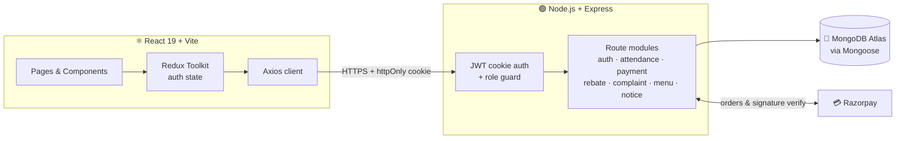
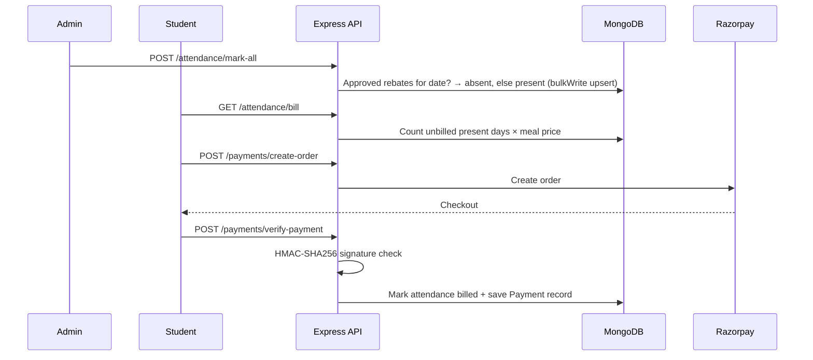

<div align="center">


# 🍽️ eSmartMess

### Digitizing hostel mess operations: attendance, billing, rebates and payments in one platform.

<!-- [](https://smart-mess-chi.vercel.app) -->


</div>

---

## 📌 Why eSmartMess?

Hostel mess management usually runs on paper registers and cash collection. That means billing disputes, lost attendance records, unclear rebate rules and no complaint trail.

**eSmartMess replaces that with a role-based web platform.** Admins mark attendance for the whole hostel in one click. Bills are generated automatically from attendance. Students pay online and the payment is cryptographically verified. Approved rebates (leave periods) flow straight into attendance, so nobody is billed for days they were away.

---

## 🎯 Outcomes at a Glance

| | |
|---|---|
| ⚡ **One-click attendance** | Marks every student for a day with a single batched `bulkWrite` instead of N separate DB calls |
| 🧾 **Zero-manual billing** | Bill = unpaid present days × meal price, computed server-side from attendance |
| 🔐 **Verified payments** | Razorpay payments confirmed with HMAC-SHA256 signature checks before any record is written |
| 🏖️ **Rebate-aware automation** | Students on an approved rebate are automatically marked absent, so they are never billed |
| 🛡️ **Role-based access** | 2 roles (Student / Admin) enforced by middleware on every protected route |
| 📦 **Full-stack scope** | 7 feature modules · 7 MongoDB collections · 25+ REST endpoints · 16 UI pages |

---

## ✨ Features

<table>
<tr>
<td width="50%" valign="top">

### 🧑‍🎓 Student
- 🔑 Register / login with a secure session
- 📅 View personal attendance and pending bill
- 💳 Pay mess bills online via **Razorpay**
- 🏖️ Apply for a **rebate** over a date range and track its status
- 📝 File complaints and track resolution
- 📢 Read the noticeboard
- 🍛 Check the weekly mess menu

</td>
<td width="50%" valign="top">

### 👨‍💼 Admin
- 📊 Dashboard with live stats (students, pending complaints, notices)
- ✅ Mark attendance individually or **for all students at once**
- 💰 View pending bills and full payment history (paginated)
- 🏷️ Approve or reject rebate requests
- 🛠️ Review and resolve complaints (pending / resolved filter)
- 🍽️ Add, update and delete the weekly menu
- 📣 Create, edit and delete notices

</td>
</tr>
</table>

---

## 🏗️ Architecture



### 💳 Billing and payment flow



---

## 🧠 Engineering Highlights

- **Tamper-proof payments:** the server recomputes the Razorpay HMAC-SHA256 signature (`order_id|payment_id`) and rejects any mismatch before touching the database. Orders are created with `payment_capture` enabled.
- **Efficient bulk operations:** marking a whole hostel present builds one `bulkWrite` of upserts, which is idempotent (re-running the same date never creates duplicates) and avoids N+1 round trips.
- **Business rule automation:** rebate ranges are checked against the target date with `$lte` / `$gte`, and rebate students are stored in a `Set` for O(1) lookups while building the batch.
- **Billing integrity:** an `is_billed` flag on each attendance record guarantees a day can never be charged twice. A compound filter (`studentId + date`) keeps one record per student per day.
- **Secure auth:** passwords hashed with bcrypt (salted, pre-save hook), JWT in `httpOnly`, `secure`, `sameSite=none` cookies for cross-origin deployment, and no tokens exposed to JS storage.
- **Authorization by design:** `userAuth` and `isAdmin` middleware plus per-resource ownership checks (a student can only read or pay their own bill).
- **Scalable listing:** payment history uses server-side pagination (`page`, `limit`, `totalPages`) with `populate` for student names.
- **Client-side route protection:** `ProtectedRoute` and `RequireGuest` wrappers keep each role in its own area, with an `Unauthorized` page for violations.
- **Serverless deployment:** frontend and backend are deployed on Vercel with environment-based configuration.

---

## 🛠️ Tech Stack

| Layer | Technologies |
|---|---|
| **Frontend** | React 19, Vite, Redux Toolkit, React Router 7, Tailwind CSS, Axios, React-Toastify, React-Datepicker, Lucide / React-Icons |
| **Backend** | Node.js, Express 4, Mongoose 8, JWT, bcryptjs, cookie-parser, CORS |
| **Database** | MongoDB |
| **Payments** | Razorpay (orders + signature verification) |
| **Deployment** | Vercel (frontend + backend), Vercel Analytics |

---

## 🔌 API Reference

> Base path: `/api` · 🔒 = login required · 🛡️ = admin only

<details>
<summary><b>Auth & Users</b> — <code>/api/user</code></summary>

| Method | Endpoint | Access | Description |
|---|---|---|---|
| POST | `/register` | Public | Create a student account |
| POST | `/login` | Public | Login, sets httpOnly cookie |
| POST | `/logout` | Public | Clear session cookie |
| GET | `/profile` | 🔒 | Current user (password excluded) |
| GET | `/stats` | 🛡️ | Dashboard counts |
</details>

<details>
<summary><b>Attendance & Billing</b> — <code>/api/attendance</code></summary>

| Method | Endpoint | Access | Description |
|---|---|---|---|
| POST | `/mark` | 🛡️ | Mark one student present/absent |
| POST | `/mark-all` | 🛡️ | Bulk mark all students (rebate-aware) |
| GET | `/bill` | 🔒 | Amount due for a student |
| GET | `/my-attendance` | 🔒 | Logged-in student's records |
| GET | `/pending` | 🔒 | Pending bills overview |
</details>

<details>
<summary><b>Payments</b> — <code>/api/payments</code></summary>

| Method | Endpoint | Access | Description |
|---|---|---|---|
| POST | `/create-order` | 🔒 | Create Razorpay order |
| POST | `/verify-payment` | 🔒 | Verify signature, record payment |
| GET | `/all` | 🛡️ | Paginated payment history |
</details>

<details>
<summary><b>Rebates · Complaints · Menu · Notices</b></summary>

| Module | Endpoints |
|---|---|
| **Rebate** `/api/rebate` | `POST /apply` · `GET /my-rebates` · `GET /all` 🛡️ · `PUT /update/:id` 🛡️ |
| **Complaint** `/api/complaint` | `POST /create` · `GET /my-complaints` · `GET /all` 🛡️ · `GET /pending` 🛡️ · `PUT /resolve/:id` 🛡️ |
| **Menu** `/api/menu` | `GET /get` · `POST /add` 🛡️ · `PUT /update/:day` 🛡️ · `DELETE /delete/:day` 🛡️ |
| **Notice** `/api/notice` | `GET /all` · `POST /create` 🛡️ · `PUT /update/:id` 🛡️ · `DELETE /delete/:id` 🛡️ |
</details>

---

## 🗃️ Data Model

```
User ──┬──< Attendance   (studentId, date, status, is_billed)
       ├──< Payment      (studentId, amount, orderId, transactionId, status)
       ├──< Rebate       (studentId, startDate, endDate, status)
       └──< Complaint    (studentId, description, status)

Menu    (day [unique], breakfast, lunch, dinner)
Notice  (title, content, createdAt)
```

---

## 📁 Project Structure

```
eSmartMess/
├── backend/
│   ├── config/         # MongoDB connection
│   ├── middlewares/    # userAuth, isAdmin
│   ├── models/         # User, Attendance, Payment, Rebate, Complaint, Menu, Notice
│   ├── routes/         # auth, attendance, payment, rebate, complaint, menu, notice
│   └── server.js
└── frontend/
    └── src/
        ├── components/ # Navbar, Sidebars, AttendanceTable, ProtectedRoute …
        ├── pages/      # Student* and Admin* screens
        ├── redux/      # store + auth/sidebar slices
        └── axios/      # configured API client
```

---

## 🚀 Getting Started

**Prerequisites:** Node.js 18+, a MongoDB URI, and Razorpay test keys.

```bash
# 1. Clone
git clone https://github.com/<your-username>/SmartMess.git
cd SmartMess

# 2. Backend
cd backend && npm install
npm run dev          # http://localhost:3000

# 3. Frontend (new terminal)
cd frontend && npm install
npm run dev          # http://localhost:5173
```

**`backend/.env`**
```env
PORT=3000
MONGODB_URI=<your-mongodb-connection-string>
JWT_SECRET=<long-random-string>
RAZORPAY_KEY_ID=<test-key-id>
RAZORPAY_KEY_SECRET=<test-key-secret>
```

> 🔑 **Admin accounts** are intentionally not creatable from the UI. Seed one directly in the database or through a protected script.

<!-- ```
POST /api/admin/register
```
With the following body:
```json
{
  "role": "admin",
  "email": "example@gmail.com",
  "password": "admin"
}
``` -->
---

## 🗺️ Roadmap

- [ ] 🔒 Planned hardening: force `student` role on public signup, compute payment amounts server-side only, and remove the unguarded manual pay-bill route
- [ ] ✅ Request validation with Zod / Joi and rate limiting
- [ ] 🧪 Unit and integration tests (Jest + Supertest)
- [ ] 📧 Email / SMS notifications for bills and rebate decisions
- [ ] 📈 Admin analytics: attendance trends and revenue charts
- [ ] 🐳 Dockerized setup and CI pipeline

---

## 👨‍💻 Author

**Sahil Chhillar** · Computer Engineering Graduate, NIT Kurukshetra'26

[](https://github.com/Sahiil-Chhillar)
[](https://www.linkedin.com/in/sahil-chhillar/)

<div align="center">

⭐ If you found this project useful, consider giving it a star!

</div>